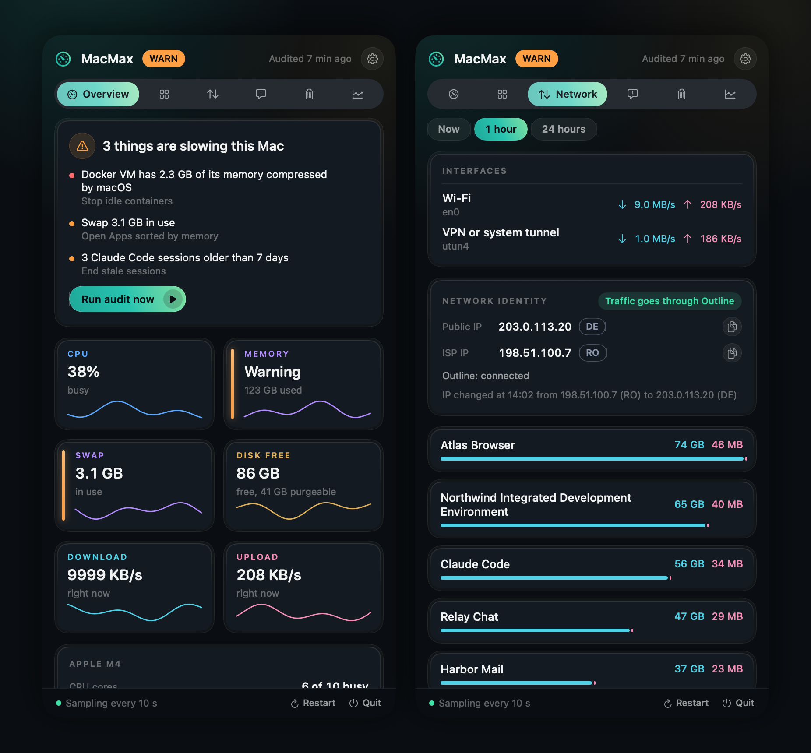
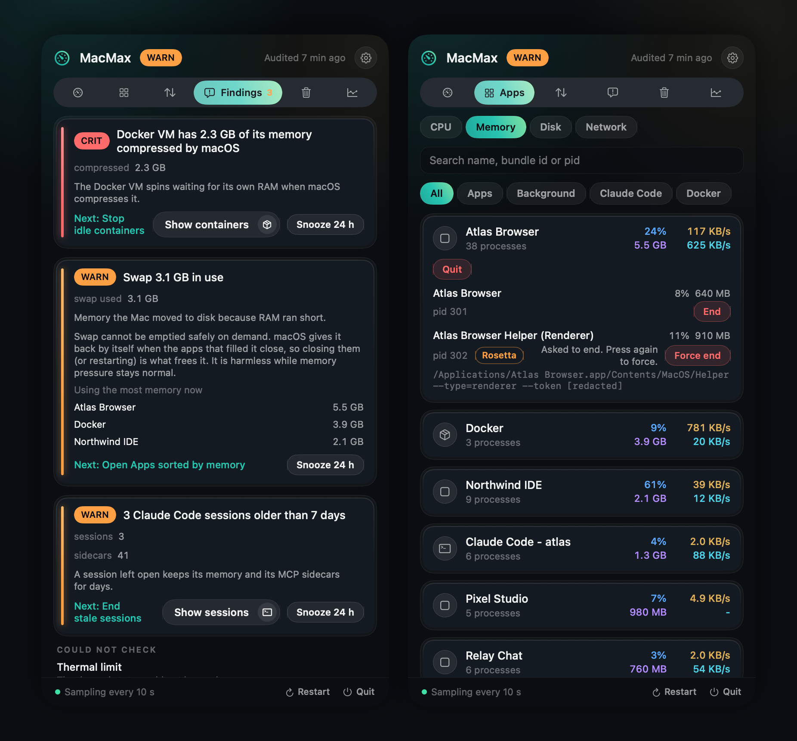
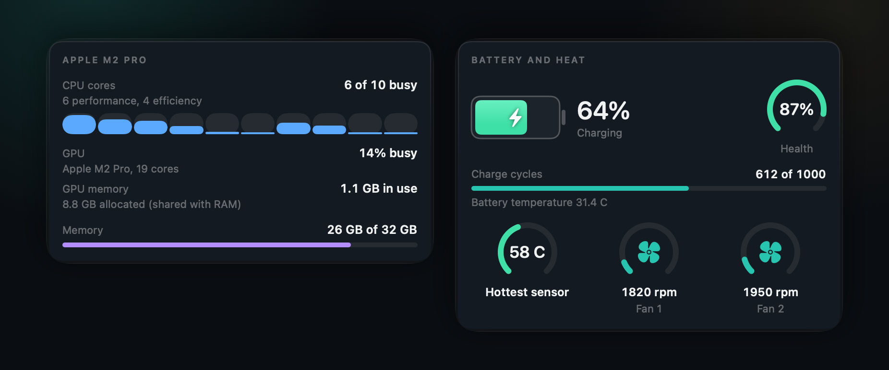
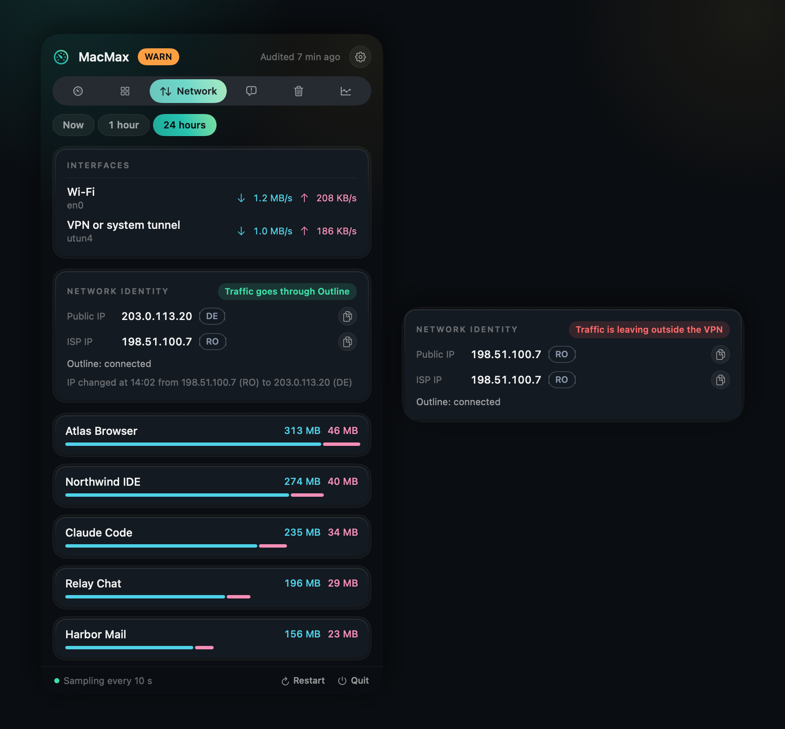
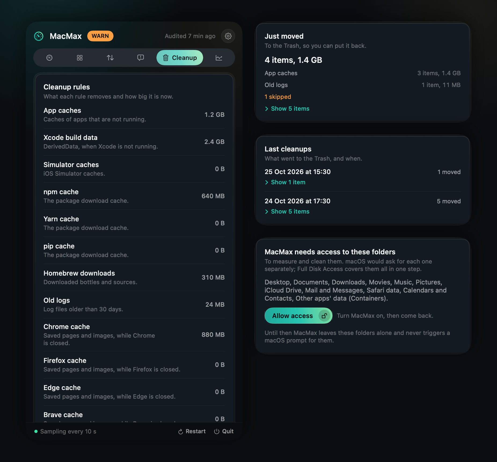
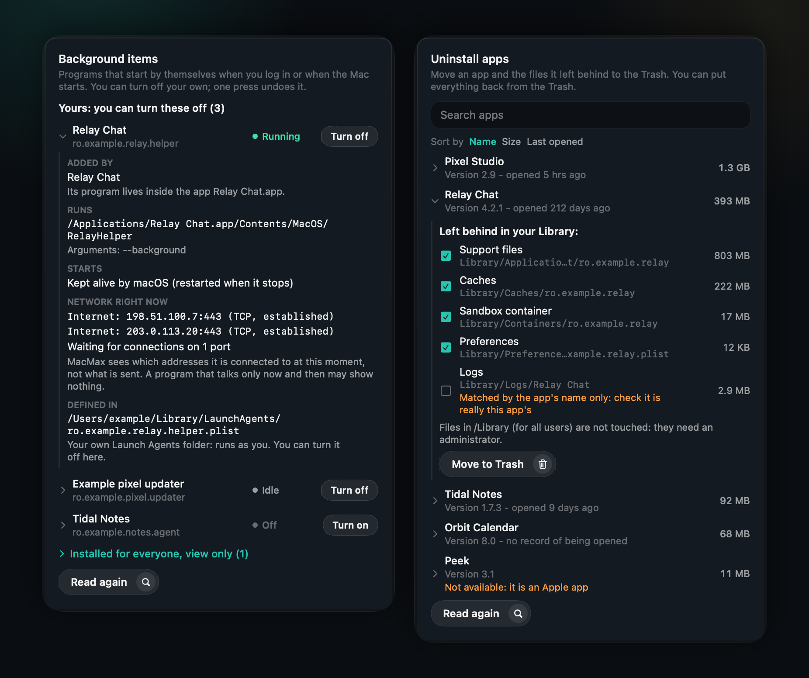
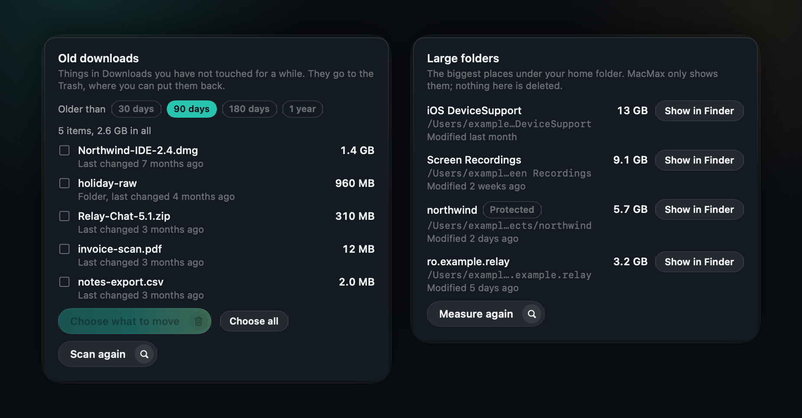
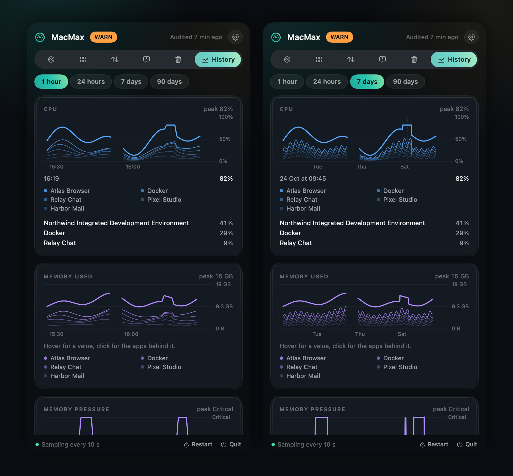
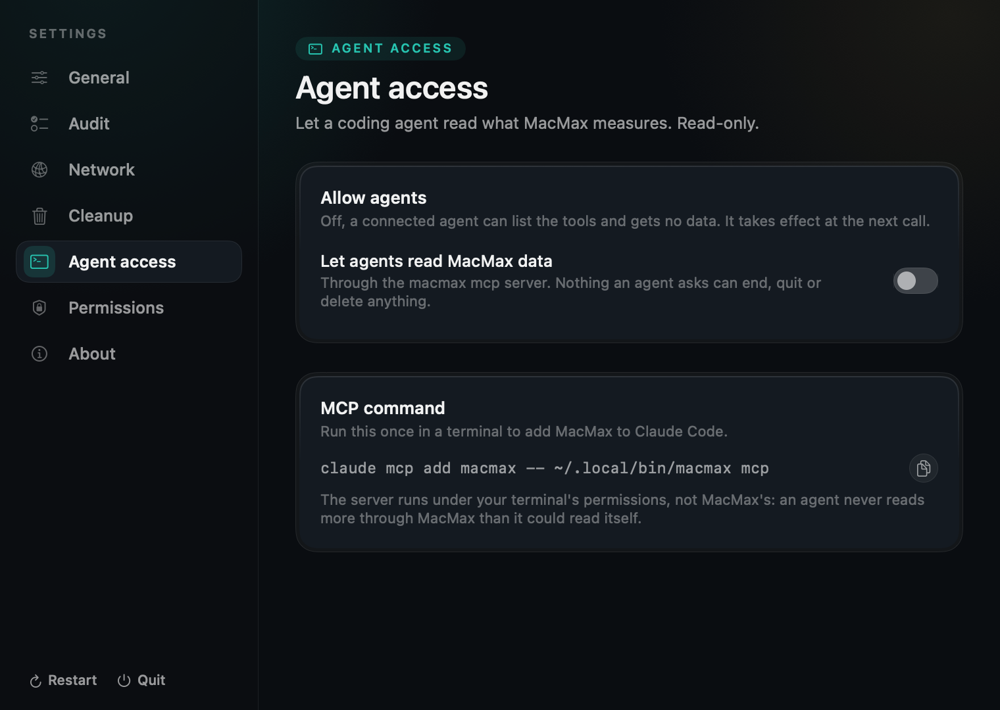

<p align="center">
  
</p>

<h1 align="center">MacMax</h1>

<p align="center">
  <b>Why is my Mac slow? One answer, from the menu bar.</b><br>
  MacMax shows what is using your Mac, checks it on a schedule, and tells you what to close,<br>
  what to clean and whether your VPN is really on.
</p>

<p align="center">
  
  
  
  
</p>

<!-- The launch film (brag-output/macmax.mp4), uploaded through the GitHub editor: a user-attachments
     URL on its own line is the only way GitHub plays video inline. The source and the music-only
     fallback are rebuilt by the brag workflow, see docs/SCREENSHOTS.md. -->

https://github.com/user-attachments/assets/a13068de-d5aa-493e-85d8-9aee83f225b7

> **Status:** early releases. By using MacMax you accept that it may have bugs; a wrong or missing
> reading is one worth reporting at
> [github.com/danieltamas/macmax/issues](https://github.com/danieltamas/macmax/issues). The app is
> signed ad hoc, not notarized, so macOS asks you to confirm the first open.

## Install

Open **Terminal** (Spotlight, type "Terminal") and paste this:

```bash
curl -fsSL https://raw.githubusercontent.com/danieltamas/macmax/main/install.sh | bash
```

Or, with Homebrew:

```bash
brew install --cask danieltamas/tap/macmax
```

That is all. No admin password, no developer tools. It needs macOS 13 or newer, on
Apple silicon or Intel. MacMax appears in the menu bar a few seconds later.

- **What the line does:** downloads the latest release from GitHub, checks it against the published
  checksum, and copies MacMax to `/Applications` (or `~/Applications` if you cannot write there).
  [Read the script](install.sh) first if you like; it is short.
- **Homebrew:** the cask pins each release by checksum and installs the `macmax` command too.
  The install line also records the cask as trusted in Homebrew 7, so `brew upgrade --cask macmax`
  updates it afterwards. The app's own Update button works as well; run the brew upgrade once
  afterwards so Homebrew's record matches.
- **Prefer a download?** Take `MacMax-X.Y.Z.zip` from the
  [Releases page](https://github.com/danieltamas/macmax/releases), unzip it and drag MacMax to
  Applications. macOS asks you to confirm the first time: right-click the app, then Open.
- **Updating:** when a new version is out, an arrow appears in the panel header. Press it, then
  Update in Settings, About. Or run the install line again.

## One answer

The menu bar icon turns **OK**, **WARN** or **CRIT**. Open it and you see the few things that
matter, each with the numbers behind it, why it slows the Mac, and the button that fixes it.

<p align="center">
  
</p>

A slow afternoon, explained:

| | |
|---|---|
| **CRIT** | Docker's VM has 2.3 GB of its memory squeezed by macOS, so it crawls. **Stop idle containers.** |
| **WARN** | 3 Claude Code sessions older than 7 days still hold 1.8 GB and 41 helper processes. **End them.** |
| **WARN** | 3.1 GB of swap is in use: what you run does not fit in 16 GB of memory. Atlas Browser holds 5.5 GB. |
| **OK** | Your traffic goes through your VPN as 203.0.113.20 (DE). Your ISP address stays hidden. |

Nothing is guessed: every finding names the numbers that fired it, and the checks are the same
every time (fixed thresholds you can edit in Settings).

## What fired it, and what it costs

<p align="center">
  
</p>

- **Findings** shows what fired, the reading that fired it, and the one press that fixes it.
- **Apps** shows the real cost of each app: CPU, memory, disk and network. Apps are grouped the way
  you think of them: Chrome's 38 helpers are one row, an agent session and its helper processes are
  one row. Expand a row to see its processes. Memory is the number Activity Monitor shows.

## Know your Mac

<p align="center">
  
</p>

- **This Mac:** chip, cores in use and how busy the efficiency and performance clusters are, CPU
  time split into user, system and idle, the load averages, uptime, GPU and its memory, RAM.
- **Battery and heat:** how worn the battery is (its maximum capacity against the original, and the
  charge cycles used against the rated number), the speed of each fan and the hottest of the
  sensors MacMax can name (the SMC limit keys that read 100 C all day are left out). Below them, every sensor MacMax can name, in groups: the CPU cores it can tell
  apart, the GPU, memory, storage, the wireless chip, the battery cells and the airflow, with the
  hottest and the average per group, plus what the Mac draws at the wall and on each Thunderbolt
  port. The numbers
  come from the battery's own registry entry and the System Management Controller, with no
  administrator needed. A Mac without a battery or fans says so; a reading that fails says
  "unknown", never "fine", and a sensor MacMax cannot name is not listed.

## Is your VPN really on?

<p align="center">
  
</p>

- **Traffic per app,** now, over the last hour or the last 24 hours, with the totals per interface.
- **The identity card** shows your public address, your ISP's address and which one the world sees.
  When the VPN says connected but your ISP address still shows, the card turns red.
- MacMax reads the counters macOS already keeps. It does not capture or look inside your traffic.
  It works with Outline, Tailscale, WireGuard and other VPNs.

## Cleanup that cannot hurt you

<p align="center">
  
</p>

- **To the Trash, after you confirm.** Everything can be put back.
- **What it covers:** app caches, Xcode build data, npm, pip and Homebrew downloads, browser caches,
  the copies Mail made of opened attachments, and old logs. Each rule is sized and previewed first.
- **What it never touches:** your documents, keychains, mail, language files (removing them breaks
  an app's signature) and any folder with a `.git` inside.
- **One permission prompt** instead of thirteen: a single list of the folders MacMax needs.
- MacMax can also end leftover helper processes (stale agent servers, parents that never collected
  finished children), only when you press the button.

## What starts by itself, and what apps leave behind

<p align="center">
  
</p>

- **Background items** lists the programs macOS starts by itself: your Launch Agents and the
  system's. You can turn off your own, and turn them on again. The system-wide ones are only listed,
  because changing them needs an administrator and MacMax never asks for that.
- **Click an item** to see who added it (the app it belongs to, or a clearly marked guess from its
  name), what it runs, when it starts, and, while it is running, the addresses it is connected to
  right now. MacMax shows where a program connects, not what it sends.
- **Uninstall apps** lists the apps in `/Applications` and `~/Applications`. Pick one to see what it
  left in your Library (support files, caches, preferences, containers, logs, saved state, its launch
  agent) with sizes, untick anything you want to keep, and move the lot to the Trash after one
  confirmation. A closed app often leaves an updater or helper running; the same press ends those
  first.
- Each app shows when it was last opened (from Spotlight's record; "no record" is not "never"), and
  the list sorts by name, size or last opened. It never touches an app that is open, an Apple app,
  MacMax itself, or anything in `/Library`. Files matched only by the app's name are listed but
  start unticked.

## Old downloads and large folders

<p align="center">
  
</p>

- **Old downloads:** what has sat in Downloads for months. MacMax moves only what you tick.
- **Large folders:** the biggest folders under your home folder, shown, never deleted.

## History

<p align="center">
  
</p>

CPU, memory, swap, disk and network, from the last hour to the last 90 days. Point at a spike to
see which apps held the Mac at that moment.

## Ask your coding agent

`macmax mcp` lets Claude Code, or any MCP client, read the same data: "what is slowing my Mac?"
gets an answer from real numbers. **It is off until you turn it on** in Settings, Agent access, and
every tool is read-only: quitting or cleaning is always a press in the app.

<p align="center">
  
</p>

## What MacMax will not do

On purpose, MacMax will not have a malware scanner, a file shredder or "speed boost" buttons: they
promise more than they can do.

## Questions

**Does it work on Intel Macs?** The download is universal: one app that runs on Apple silicon and
Intel. A reading a Mac does not have (performance and efficiency cores exist only on Apple silicon)
shows as unavailable, never as a made-up number.

**It lost Full Disk Access after an update.** MacMax is not signed with a paid Apple developer
certificate, so macOS treats each new version as a new app. Turn MacMax on again in System
Settings, Privacy & Security, Full Disk Access. Everything else works without it.

**Can I free my swap?** Not safely: swap is memory that macOS moved to disk and gives back by
itself when the apps that need it close or restart. Close the apps MacMax names, or restart.

**Can it show memory per Chrome tab?** No. Only Chrome's own Task Manager can (Window, Task
Manager).

**What will it never do?** Block traffic, run anything as root, or end or delete anything without
your press.

**I found a bug.** Open an issue at
[github.com/danieltamas/macmax/issues](https://github.com/danieltamas/macmax/issues): macOS
version, Mac model, what you did, what you expected and what MacMax showed. Early releases have
bugs, and the report is how they get fixed.

## Privacy and security

MacMax makes three kinds of network request and no others: the IP check (to `1.1.1.1` by default;
editable or off in Settings, Network), the update check (GitHub's releases API), and, only when you
open Settings, More apps, the same API for the latest release of each app listed there (at most
every six hours unless you press refresh). No telemetry, no
analytics, no account. Everything it records stays in `~/.macmax` on your Mac, readable only by
you. Command lines are redacted before they are stored or shown, so tokens in other apps' arguments
never land in its history. The agent server listens on no port: it talks only to the program that
started it. The threat model is in [`SECURITY.md`](SECURITY.md).

<details>
<summary><b>Command line</b></summary>

```bash
macmax snapshot            # verdict, vitals, top apps, IP and VPN
macmax apps --by memory    # apps by CPU, memory, disk or network
macmax network --window 1h # traffic per app
macmax ip                  # public IP, ISP IP, VPN state, leak verdict
macmax audit               # a fresh audit; exits 0 OK, 1 WARN, 2 CRIT, 3 unknown
macmax history swap --range 7d
macmax mcp                 # the read-only agent server on stdio
```

Add `--json` to any command. Everything MacMax keeps lives in `~/.macmax` (or `$MACMAX_HOME`).
To connect your agent: turn on Settings, Agent access, then
`claude mcp add macmax -- ~/.local/bin/macmax mcp`.

</details>

<details>
<summary><b>Build from source</b></summary>

```bash
git clone https://github.com/danieltamas/macmax.git && cd macmax
scripts/install-from-source.sh
```

Needs Xcode with Swift 6.2, which runs on macOS 15 or newer; the app it builds runs on macOS 13 or
newer, so an older Mac installs the release zip above. `scripts/check.sh` builds and runs the suite.
Releases are reproducible: `scripts/release.sh <x.y.z> --verify` builds twice and fails if one byte
differs.

</details>

<details>
<summary><b>Uninstall</b></summary>

```bash
curl -fsSL https://raw.githubusercontent.com/danieltamas/macmax/main/install.sh | bash -s -- --uninstall
```

Removes the app and the `macmax` command, and keeps your history in `~/.macmax` unless you add
`--purge` after `--uninstall`. If you connected an agent: `claude mcp remove macmax`.

</details>

## License

MIT. Product names shown in MacMax identify the apps it measures and belong to their owners.
