<p align="center">
  
</p>

<h1 align="center">MacMax</h1>

<p align="center">
  <b>Why is my Mac slow? One answer, from the menu bar.</b><br>
  MacMax shows what is using your Mac, checks it on a schedule, and tells you what to close,<br>
  what to clean and whether your VPN is really on.
</p>

<p align="center">
  
  
  
  
</p>

<p align="center">
  
</p>

> **Status:** in development, nothing is released yet. The install line below works from v0.1.0.

## Install

Open **Terminal** (Spotlight, type "Terminal") and paste this:

```bash
curl -fsSL https://raw.githubusercontent.com/danieltamas/macmax/main/install.sh | bash
```

That is all. No admin password, no Homebrew, no developer tools. It needs macOS 14 or newer, on
Apple silicon or Intel. MacMax appears in the menu bar a few seconds later.

- **What the line does:** downloads the latest release from GitHub, checks it against the published
  checksum, and copies MacMax to `/Applications` (or `~/Applications` if you cannot write there).
  [Read the script](install.sh) first if you like; it is short.
- **Prefer a download?** Take `MacMax-X.Y.Z.zip` from the
  [Releases page](https://github.com/danieltamas/macmax/releases), unzip it and drag MacMax to
  Applications. macOS asks you to confirm the first time: right-click the app, then Open.
- **Updating:** when a new version is out, an arrow appears in the panel header. Press it, then
  Update in Settings, About. Or run the install line again.

## What you get

### One answer: is this Mac healthy, and if not, why?

The menu bar icon turns **OK**, **WARN** or **CRIT**. Open it and you see the few things that
matter, each with the numbers behind it, why it slows the Mac, and the button that fixes it.

<table>
  <tr>
    <td width="50%" valign="top">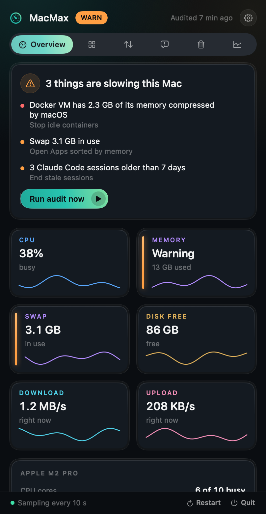</td>
    <td width="50%" valign="top">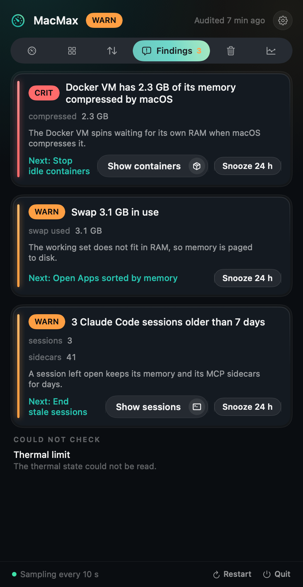</td>
  </tr>
  <tr>
    <td align="center"><b>Overview</b>: the verdict and live numbers</td>
    <td align="center"><b>Findings</b>: what fired, why, and the fix</td>
  </tr>
</table>

A slow afternoon, explained:

| | |
|---|---|
| **CRIT** | Docker's VM has 2.3 GB of its memory squeezed by macOS, so it crawls. **Stop idle containers.** |
| **WARN** | 3 Claude Code sessions older than 7 days still hold 1.8 GB and 41 helper processes. **End them.** |
| **WARN** | 3.1 GB of swap is in use: what you run does not fit in 16 GB of memory. Atlas Browser holds 5.6 GB. |
| **OK** | Your traffic goes through your VPN as 203.0.113.20 (DE). Your ISP address stays hidden. |

Nothing is guessed: every finding names the numbers that fired it, and the checks are the same
every time (fixed thresholds you can edit in Settings).

### Know your Mac

<table>
  <tr>
    <td width="50%" valign="top">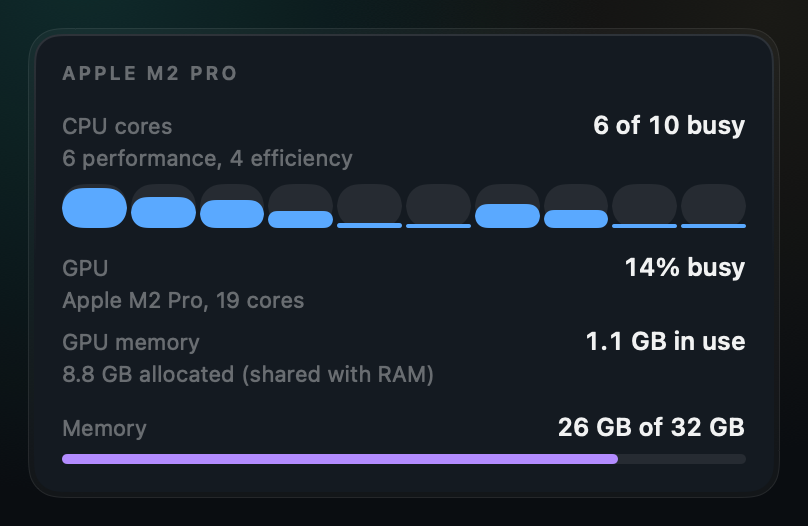</td>
    <td width="50%" valign="top">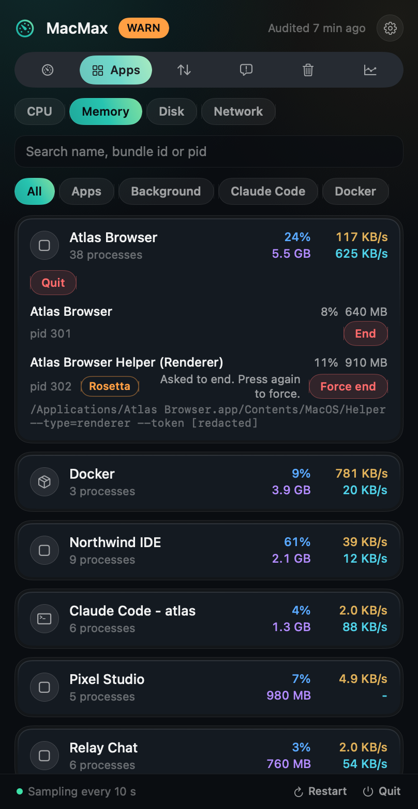</td>
  </tr>
  <tr>
    <td align="center"><b>This Mac</b>: chip, cores in use, GPU and its memory, RAM</td>
    <td align="center"><b>Apps</b>: the real cost of each app</td>
  </tr>
</table>

Apps are grouped the way you think of them: Chrome's 38 helpers are one row, an agent session and
its helper processes are one row. Expand a row to see its processes. Memory is the number Activity
Monitor shows.

### Network: who is using it, and is your VPN really on

<table>
  <tr>
    <td width="50%" valign="top">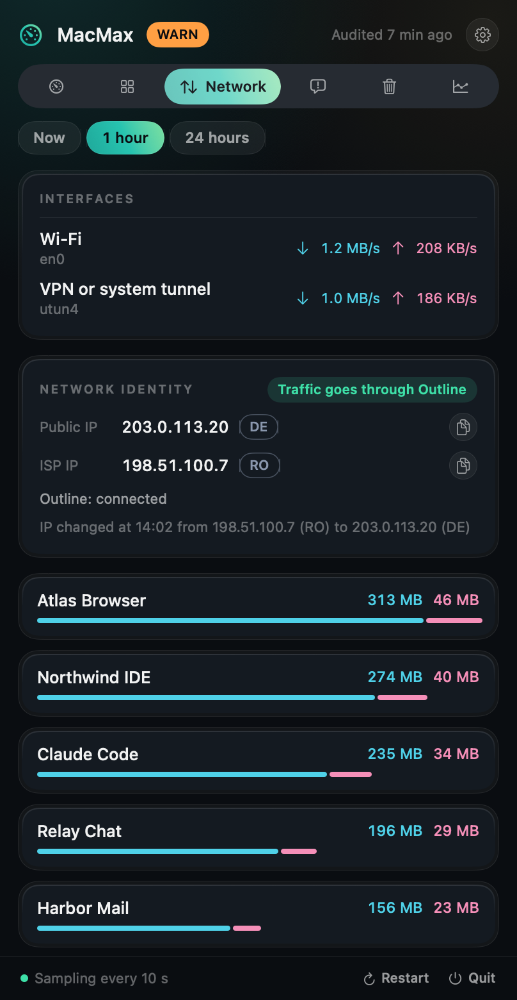</td>
    <td width="50%" valign="top">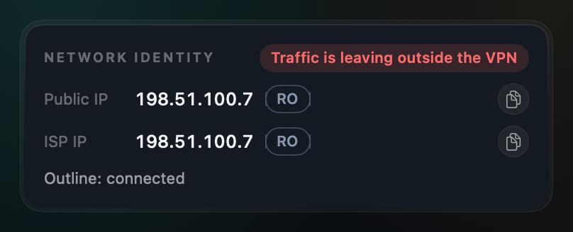</td>
  </tr>
  <tr>
    <td align="center"><b>Traffic per app</b>, now, 1 hour or 24 hours</td>
    <td align="center"><b>A leak</b>, in red: the VPN says connected, your ISP address still shows</td>
  </tr>
</table>

MacMax reads the counters macOS already keeps. It does not capture or look inside your traffic. It
works with Outline, Tailscale, WireGuard and other VPNs.

### Cleanup that cannot hurt you

<table>
  <tr>
    <td width="50%" valign="top">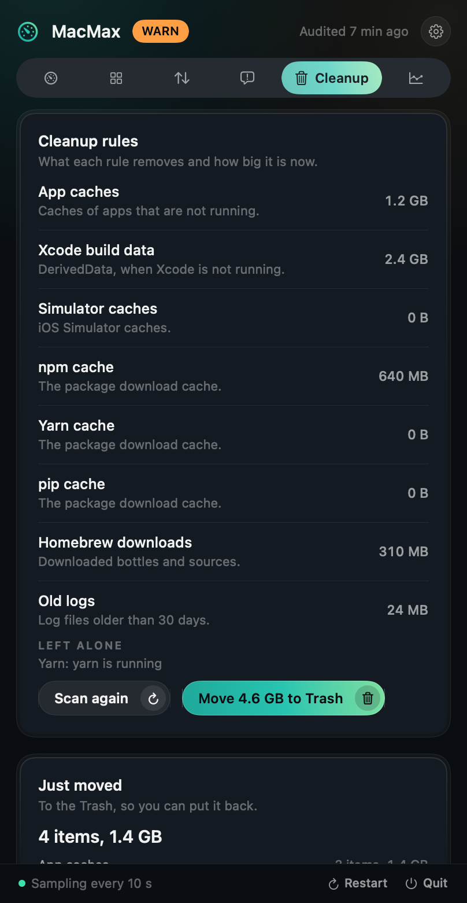</td>
    <td width="50%" valign="top">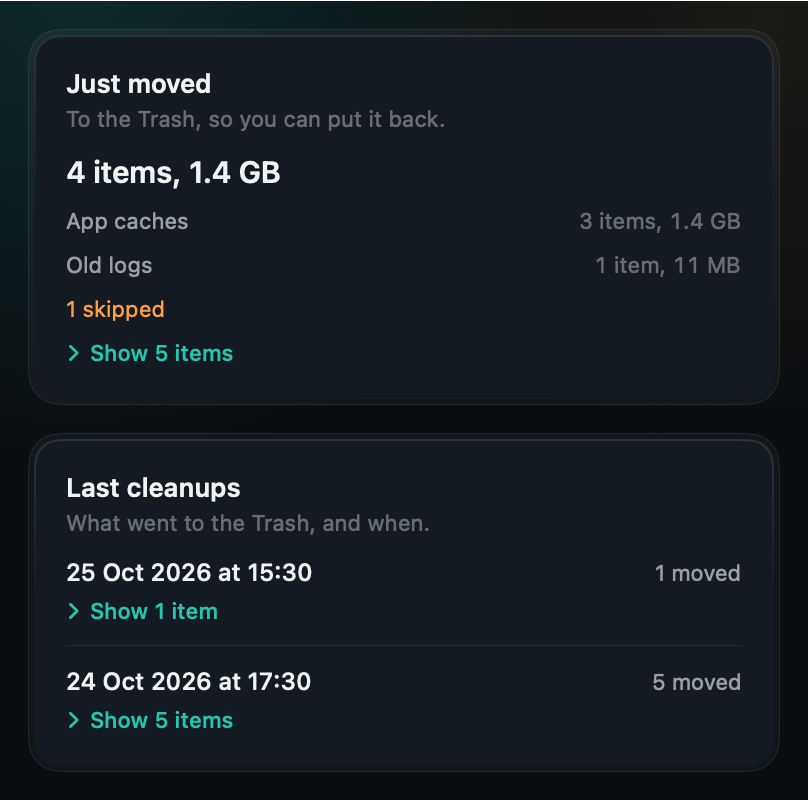</td>
  </tr>
  <tr>
    <td align="center"><b>Rules</b>: caches that rebuild themselves, sized and previewed</td>
    <td align="center"><b>Results</b>: a summary, and the items one click away</td>
  </tr>
  <tr>
    <td width="50%" valign="top">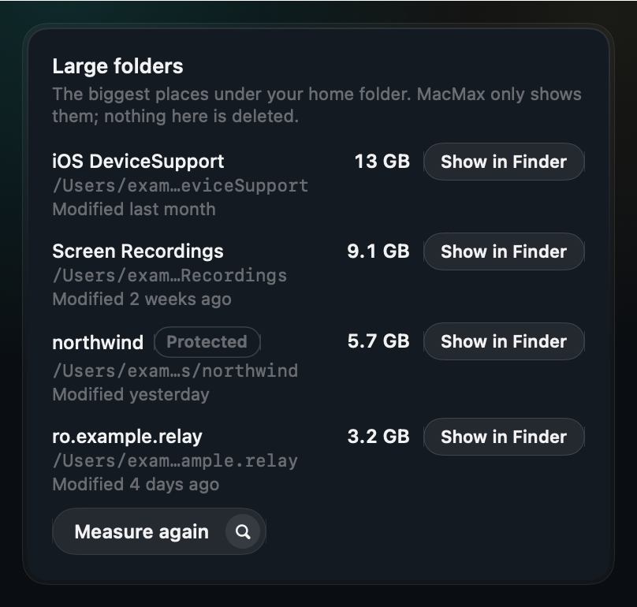</td>
    <td width="50%" valign="top">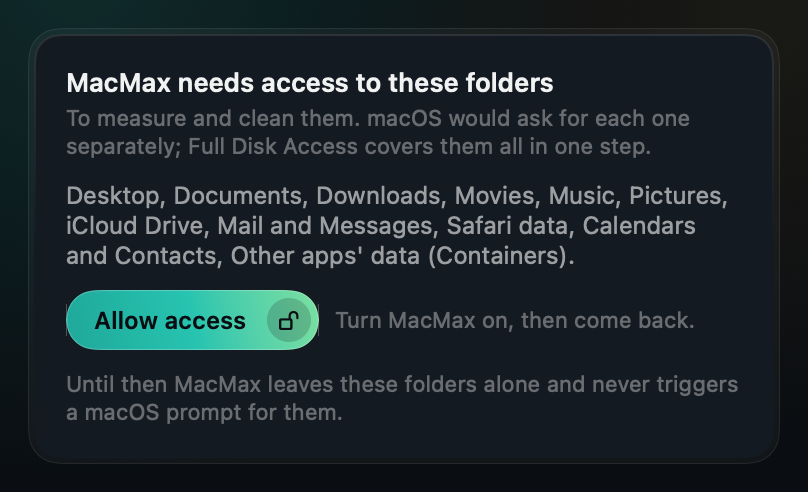</td>
  </tr>
  <tr>
    <td align="center"><b>Large folders</b>: shown, never deleted</td>
    <td align="center"><b>One permission prompt</b> instead of thirteen</td>
  </tr>
</table>

Cleanup moves things to the **Trash**, so you can put them back, and only after you confirm. It
covers app caches, Xcode build data, npm, pip and Homebrew downloads, and old logs. Your documents,
keychains, mail and any folder with a `.git` inside are never touched. MacMax can also end leftover
helper processes (stale agent servers, parents that never collected finished children), only when
you press the button.

### History

<p align="center">
  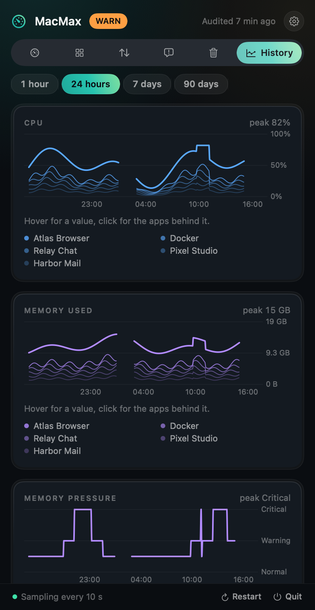
</p>

CPU, memory, swap, disk and network, from the last hour to the last 90 days. Point at a spike to
see which apps held the Mac at that moment.

### Ask your coding agent

`macmax mcp` lets Claude Code, or any MCP client, read the same data: "what is slowing my Mac?"
gets an answer from real numbers. **It is off until you turn it on** in Settings, Agent access, and
every tool is read-only: quitting or cleaning is always a press in the app.

<p align="center">
  
</p>

## Coming next

Features of Mac cleaners that fit MacMax, built one at a time after the first release. They are
not in the app yet.

- **Login items and background agents:** see everything that starts with your Mac and turn it off
  with a press, reversibly.
- **App uninstaller:** remove an app together with its leftovers (preferences, caches, support
  files), to the Trash, after one confirmation.
- **Battery health, temperatures and fans.**
- **More cleanup:** Mail attachments, language files, browser caches, and a list of old downloads.

On purpose, MacMax will not have a malware scanner, a file shredder or "speed boost" buttons: they
promise more than they can do.

## Questions

**Does it work on Intel Macs?** The download is universal: one app that runs on Apple silicon and
Intel. A reading a Mac does not have (performance and efficiency cores exist only on Apple silicon)
shows as unavailable, never as a made-up number.

**It lost Full Disk Access after an update.** MacMax is not signed with a paid Apple developer
certificate, so macOS treats each new version as a new app. Turn MacMax on again in System
Settings, Privacy & Security, Full Disk Access. Everything else works without it.

**Can I free my swap?** Not safely: swap is memory that macOS moved to disk and gives back by
itself when the apps that need it close or restart. Close the apps MacMax names, or restart.

**Can it show memory per Chrome tab?** No. Only Chrome's own Task Manager can (Window, Task
Manager).

**What will it never do?** Block traffic, run anything as root, or end or delete anything without
your press.

## Privacy and security

MacMax makes two network requests and no others: the IP check (to `1.1.1.1` by default; editable
or off in Settings, Network) and the update check (GitHub's releases API). No telemetry, no
analytics, no account. Everything it records stays in `~/.macmax` on your Mac, readable only by
you. Command lines are redacted before they are stored or shown, so tokens in other apps' arguments
never land in its history. The agent server listens on no port: it talks only to the program that
started it. The threat model is in [`SECURITY.md`](SECURITY.md).

<details>
<summary><b>Command line</b></summary>

```bash
macmax snapshot            # verdict, vitals, top apps, IP and VPN
macmax apps --by memory    # apps by CPU, memory, disk or network
macmax network --window 1h # traffic per app
macmax ip                  # public IP, ISP IP, VPN state, leak verdict
macmax audit               # a fresh audit; exits 0 OK, 1 WARN, 2 CRIT, 3 unknown
macmax history swap --range 7d
macmax mcp                 # the read-only agent server on stdio
```

Add `--json` to any command. Everything MacMax keeps lives in `~/.macmax` (or `$MACMAX_HOME`).
To connect your agent: turn on Settings, Agent access, then
`claude mcp add macmax -- ~/.local/bin/macmax mcp`.

</details>

<details>
<summary><b>Build from source</b></summary>

```bash
git clone https://github.com/danieltamas/macmax.git && cd macmax
scripts/install-from-source.sh
```

Needs Xcode with Swift 6.2. `scripts/check.sh` builds and runs the suite. Releases are
reproducible: `scripts/release.sh <x.y.z> --verify` builds twice and fails if one byte differs.

</details>

<details>
<summary><b>Uninstall</b></summary>

```bash
curl -fsSL https://raw.githubusercontent.com/danieltamas/macmax/main/install.sh | bash -s -- --uninstall
```

Removes the app and the `macmax` command, and keeps your history in `~/.macmax` unless you add
`--purge` after `--uninstall`. If you connected an agent: `claude mcp remove macmax`.

</details>

## License

MIT. Product names shown in MacMax identify the apps it measures and belong to their owners.
